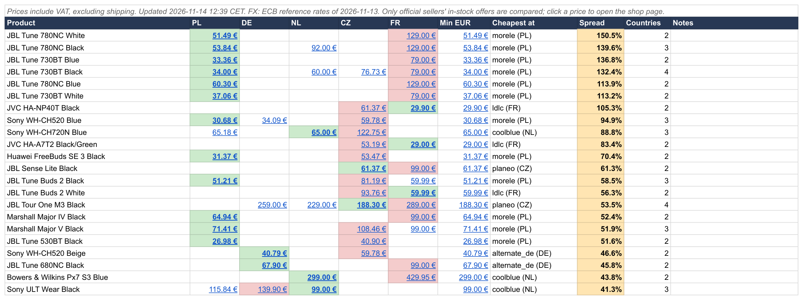
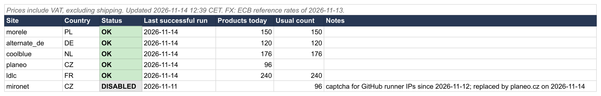
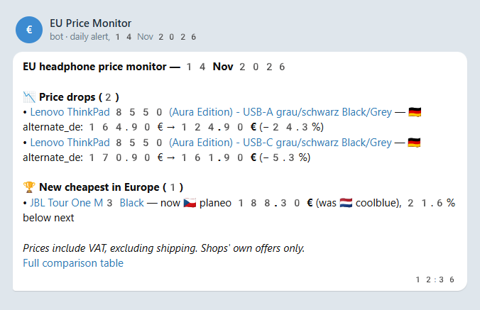

# EU Price Monitor

Daily competitor price monitoring for wireless headphones across five European online
shops (PL, DE, NL, CZ, FR). Every morning a GitHub Actions job scrapes the shops,
converts prices to EUR, matches the same product across countries, writes a Google
Sheet and sends a Telegram message when something worth knowing has changed.

**Prices** are collected exactly as each shop shows them: **VAT included, shipping excluded**.
Cross-country comparisons use the shops' own offers only (marketplace partners are stored but flagged).

| Cross-country comparison (`compare` sheet) |
|---|
|  |

| Site health (`status` sheet) | Telegram alert |
|---|---|
|  |  |

<sub>Sheet screenshots: PDF export of the live sheet after the run of 14 Nov 2026. The Telegram
image renders the exact text the bot sent that day (`alert_message.txt` from the run artifact)
in a chat bubble.</sub>

## Shops

| Country | Shop | Listing | Identifiers | Products / day |
|---|---|---|---|---|
| 🇵🇱 PL | [morele.net](https://www.morele.net) | server-rendered + JSON-LD | EAN, MPN | 150 |
| 🇩🇪 DE | [alternate.de](https://www.alternate.de) | server-rendered | EAN, MPN | 120 |
| 🇳🇱 NL | [coolblue.nl](https://www.coolblue.nl) | JSON-LD `ItemList` | MPN (no EAN published) | 176 |
| 🇨🇿 CZ | [planeo.cz](https://www.planeo.cz) | server-rendered | EAN | 96 |
| 🇫🇷 FR | [ldlc.com](https://www.ldlc.com) | JSON-LD `ItemList` | EAN, MPN | 240 |

Each site reads the first few listing pages of its wireless-headphones category, which
covers the shop's best-selling range. EAN and part number come from the product page
(usually its schema.org JSON-LD). They are fetched once per product and cached in
`data/product_ids.json`.

Run of 14 Nov 2026: **782 offers**, **76 products found in 2+ countries**, 21 in 3+,
2 in all five.

## How it works

```
sites.yaml ──► scrapers (parallel, polite) ──► site health ──► EUR ──► matching ──► Google Sheets
                    │                              │                                   │
              robots.txt, delays,            stale site? keep                   Telegram alert
              captcha = blocked              yesterday's offers                (only on changes)
```

1. **Scrape.** One scraper class per shop (`src/scrapers/`). A shared base class handles
   pagination, product pages, the identifier cache and error isolation: one failing shop
   never breaks the others.
2. **Judge site health** (`src/site_status.py`). A site is *stale* when it was blocked,
   crashed, or returned less than 70 % of its usual product count. A stale site's last
   known offers are carried over, marked stale and never alerted on.
3. **Convert to EUR** with the ECB reference rates from [frankfurter.app](https://frankfurter.app),
   fetched once a day and cached. Original price and currency are always kept.
4. **Match products** (`src/matching.py`) in three passes of decreasing reliability:
   identical EAN (check digit verified), identical part number of the same brand, then
   similar names. Only high-confidence name matches merge automatically; medium ones go
   to a review list. `config/match_overrides.yaml` holds manual merge/split decisions.
   Colour variants are separate products.
5. **Write Google Sheets** (`src/sheets.py`):
   - `compare`: one row per product offered in 2+ countries, cheapest country in green,
     priciest in red, sorted by price spread; every price links to the shop page;
   - `summary`: daily minimum per product with the change vs. yesterday and last week;
   - `today`: every offer of the day;
   - `status`: health of each site (OK / STALE / DISABLED with the reason);
   - `history`: one snapshot per day, append-only.
6. **Alert** (`src/analysis.py`, `src/notify.py`, rules in `config/alerts.yaml`):
   - price drop ≥ 5 % of one offer, in the shop's own currency (FX moves are never a "drop");
   - a product's cheapest country changed and the new leader is ≥ 1 % cheaper (FX-neutral);
   - in stock → out of stock;
   - new products, once a site has 7 days of history.

   Nothing is sent on a quiet day.

## Running on GitHub Actions

The workflow [`.github/workflows/daily.yml`](.github/workflows/daily.yml) runs every day
and can be started by hand.

### Schedule

GitHub cron uses **UTC and does not follow daylight saving time**. The job is scheduled
at **07:17 UTC**, which is **08:17 in Warsaw in winter (CET)** and **09:17 in summer (CEST)**.
It deliberately avoids `:00`, because scheduled runs at the top of the hour are often delayed.
GitHub may still start a scheduled run a few minutes late.

### What one run does

1. Scrapes the five shops (in parallel, each with its own polite delay), checks site health.
2. Converts prices to EUR, matches products, writes the `compare`, `summary`, `today`,
   `status` and `history` sheets.
3. Sends a Telegram alert if something changed (nothing is sent on a quiet day).
4. Commits the refreshed caches in `data/` back to the repository with a
   `[skip ci]` message — only when they changed (`git pull --rebase` before pushing).
5. If the run fails, or every site is stale, sends a short Telegram warning the same day.

Runs never overlap (`concurrency` group), so two runs cannot fight over `data/` or the sheet.

### Repository secrets

Settings → Secrets and variables → Actions → *New repository secret*:

| Secret | Value |
|---|---|
| `GOOGLE_CREDS` | The whole service-account JSON key, pasted as text |
| `SHEET_ID` | The spreadsheet id — the part of its URL between `/d/` and `/edit` |
| `TELEGRAM_BOT_TOKEN` | Bot token from [@BotFather](https://t.me/BotFather) |
| `TELEGRAM_CHAT_ID` | Your chat id (e.g. from [@userinfobot](https://t.me/userinfobot)); send `/start` to the bot first |

The spreadsheet must be shared with the service account's e-mail (`client_email` in the
JSON) as **Editor**, and the Google Sheets API must be enabled in its Google Cloud project.

### Checking that it works

1. **Actions → daily-price-check → Run workflow.** Leave *no_history* unticked for a
   normal run; tick it for a trial that updates the sheet without touching `history`.
2. When the run is green, open it and check:
   - the **Run price monitor** log ends with `Google Sheet updated` and either
     `Telegram message sent` or `No changes worth an alert`;
   - every site line says `OK` (a `STALE` line explains why, e.g. `HTTP 429` or `captcha`);
   - the **Commit refreshed caches** step pushed a `chore(data): refresh caches … [skip ci]`
     commit (or printed `No cache changes to commit`);
   - the **run-results** artifact holds the log, today's offers and the alert text.
3. In the sheet: the `status` tab shows today's date as *Last successful run* for every
   enabled site, and `history` has rows dated today.

## Running locally

Python 3.11.

```bash
python -m venv .venv
.venv/Scripts/activate            # Windows; on Linux/macOS: source .venv/bin/activate
pip install -r requirements.txt
cp .env.example .env              # fill in; GOOGLE_CREDS_PATH points to the JSON key file
```

```bash
python -m src.main                          # full run: all enabled sites, Sheets, Telegram
python -m src.main --no-sheets --no-telegram
python -m src.main --site planeo --max-pages 1 --no-telegram   # one site, quick check
python -m src.main --from-file data/products_2026-11-14.json   # re-match saved offers offline
python -m src.main --test-alert                                # send an example Telegram message
pytest                                                         # 122 tests, no network
```

## Project layout

```
config/
  sites.yaml            shops, category URLs, per-site politeness and seller rules
  alerts.yaml           Telegram alert thresholds and groups
  match_overrides.yaml  manual merge / split decisions for matching
src/
  main.py               pipeline and CLI
  http_client.py        robots.txt, per-host delays, block / captcha detection
  scrapers/             one class per shop + shared base, HTML and JSON-LD helpers
  identifiers.py        EAN/MPN normalisation, colour and name tokens in 5 languages
  currency.py           locale-aware price parsing, ECB rates
  matching.py           cross-shop product matching
  site_status.py        per-site health (OK / stale)
  offer_state.py        last known offer per URL, carry-over for stale sites
  analysis.py           day-over-day change detection
  tables.py, sheets.py  sheet rows and Google Sheets formatting
  notify.py             Telegram message
tests/                  unit tests; scraper tests run on HTML fixtures cut from real pages
data/                   committed caches: product ids, FX rates, site status, latest offers
```

## Limitations

- **robots.txt is respected.** Every URL is checked against the shop's robots.txt before it
  is fetched, and disallowed URLs are skipped. Requests to the same shop are 2–5 s apart
  (10–20 s for alternate.de), with an honest User-Agent that names the project.
- **No captcha or bot-check is ever bypassed.** A 403/429, a Cloudflare challenge or a
  captcha page (also one served with HTTP 200 after a redirect) counts as a block. The site
  is marked stale for the day, its last known offers are carried over, and the run goes on.
  alternate.de rate-limits fast product-page crawling, so the monitor crawls it slowly and
  fetches at most 25 new product pages a day. Its identifier cache fills up over several days.
- **One shop was replaced on day 3.** The Czech shop was originally
  [mironet.cz](https://www.mironet.cz). From 12 Nov 2026 it redirected GitHub runner IPs to an
  ALTCHA captcha (*"Ověřte, že nejste robot"*), while the same page still loaded normally from a
  home connection. Solving it would mean working around the shop's bot protection, so on
  14 Nov mironet was switched off (it stays in `sites.yaml` with `enabled: false` and the
  reason) and replaced by planeo.cz. That shop was first checked from a GitHub runner:
  robots.txt allows the category and the listing is server-rendered. mironet's rows up to
  11 Nov stay in `history`, so the CZ column changes shop on that date.
- **Datacenter IPs.** The job runs on GitHub-hosted runners, and shops may treat those IPs
  more strictly than a home connection. A shop that works locally can still block CI.
- **Top of the range, not the full catalogue.** Only the first listing pages of each
  category are read (96–240 offers per shop). A product leaving those pages is not reported
  as gone, and "new product" alerts wait for 7 days of history.
- **Matching is only as good as the data.** coolblue.nl publishes no EAN, so its offers match
  by part number or name. Medium-confidence name matches are listed for review and never
  merged automatically.
- **Prices include VAT and exclude shipping.** EUR values use one ECB reference rate per day.
  A price change is measured in the shop's own currency, so exchange-rate moves never look
  like a price drop.
- Portfolio project, not affiliated with any of the shops.
